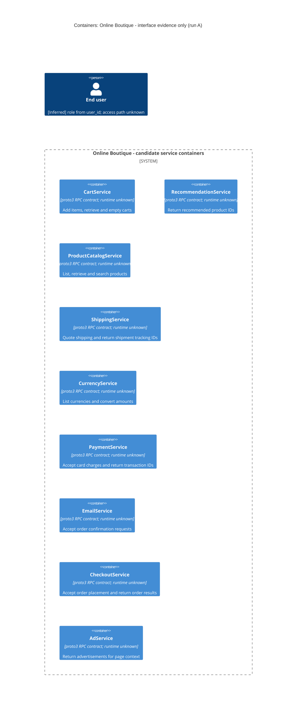

# Architecture recovery — run A

## Agent

Codex (GPT-6).

## Files read

- `prompts/1-recover-architecture.md` — task instructions.
- `system/online-boutique/protos/demo.proto` — sole architecture evidence.

## Containers table

The evidence declares nine RPC service interfaces. **[Inferred]** Each interface is shown as a candidate service container; separate deployable/runtime containers are not established by this file. Names below are the declared interface names, not verified deployment names. Protocol Buffers `proto3` is evidenced at `system/online-boutique/protos/demo.proto:15`; implementation languages and runtime technologies are **Not evidenced in the provided files**. The `go_package` option (line 19) does not establish the implementation language of any service.

| Name | Technology/language | Responsibility exposed by the contract | Evidence (file path and symbol) |
| --- | --- | --- | --- |
| CartService | proto3 RPC contract; runtime/language unknown | Add items, retrieve a user's cart, and empty a cart. | `system/online-boutique/protos/demo.proto:23–27` — `CartService.AddItem`, `GetCart`, `EmptyCart` |
| RecommendationService | proto3 RPC contract; runtime/language unknown | Return recommended product IDs for a user and supplied product IDs. | `system/online-boutique/protos/demo.proto:56–67` — `RecommendationService.ListRecommendations`, request/response fields |
| ProductCatalogService | proto3 RPC contract; runtime/language unknown | List, retrieve, and search products. | `system/online-boutique/protos/demo.proto:71–75` — `ProductCatalogService.ListProducts`, `GetProduct`, `SearchProducts` |
| ShippingService | proto3 RPC contract; runtime/language unknown | Provide shipping quotes and accept shipment requests returning a tracking ID. | `system/online-boutique/protos/demo.proto:107–128` — `ShippingService.GetQuote`, `ShipOrder`, `ShipOrderResponse.tracking_id` |
| CurrencyService | proto3 RPC contract; runtime/language unknown | List supported currencies and convert monetary amounts. | `system/online-boutique/protos/demo.proto:140–143,163–173` — `CurrencyService.GetSupportedCurrencies`, `Convert`, `CurrencyConversionRequest` |
| PaymentService | proto3 RPC contract; runtime/language unknown | Accept a card charge request and return a transaction ID. | `system/online-boutique/protos/demo.proto:177–195` — `PaymentService.Charge`, `ChargeRequest`, `ChargeResponse` |
| EmailService | proto3 RPC contract; runtime/language unknown | Accept an order confirmation request containing an email address and order details. | `system/online-boutique/protos/demo.proto:199–201,216–219` — `EmailService.SendOrderConfirmation`, `SendOrderConfirmationRequest` |
| CheckoutService | proto3 RPC contract; runtime/language unknown | Accept an order placement request and return an order result. | `system/online-boutique/protos/demo.proto:224–239` — `CheckoutService.PlaceOrder`, `PlaceOrderRequest`, `PlaceOrderResponse` |
| AdService | proto3 RPC contract; runtime/language unknown | Return advertisements for supplied page context keywords. | `system/online-boutique/protos/demo.proto:243–262` — `AdService.GetAds`, `AdRequest.context_keys`, `AdResponse.ads` |

## Dependencies table

| Caller → callee | Protocol | Evidence (file path and symbol) |
| --- | --- | --- |

**Not evidenced in the provided files.** No runtime dependency rows can be established. Service declarations specify operations, not which service calls them. Shared message types, such as `OrderResult` in `SendOrderConfirmationRequest` and `PlaceOrderResponse` (`system/online-boutique/protos/demo.proto:216–219,237–239`), do not prove a CheckoutService → EmailService call. The RPC declarations alone do not verify the deployed transport or gRPC configuration.

## Mermaid diagram

The nine candidate containers match the containers table. There are no `Rel` statements because no caller-to-callee dependencies are evidenced. **[Inferred]** The end-user role is suggested by `user_id` fields (`system/online-boutique/protos/demo.proto:34–45,228–235`); human interaction and an access path are not established. The system boundary groups the interfaces for this task and does not establish a deployment boundary.

## Gaps

For each item below: **Not evidenced in the provided files**. Suggested additional paths are candidates for a future evidence set; their existence and contents were not checked.

| Gap | Extra file that would help settle it |
| --- | --- |
| Whether each interface maps to a separately deployed container; deployment names, implementation languages, and runtime technologies. | A deployment manifest and implementation/build file for each service; candidate examples: `system/online-boutique/kubernetes-manifests/cartservice.yaml`, `system/online-boutique/src/cartservice/Dockerfile`. |
| Actual callers, dependency direction, configured endpoints, and RPC transport/security. | Client construction and invocation code plus corresponding deployment configuration; candidate examples: `system/online-boutique/src/checkoutservice/main.go`, `system/online-boutique/kubernetes-manifests/checkoutservice.yaml`. |
| User-facing entry container, human access path, and user-facing protocol. | Entry-service routing code and deployment manifest; candidate examples: `system/online-boutique/src/frontend/main.go`, `system/online-boutique/kubernetes-manifests/frontend.yaml`. |
| Data stores, persistence behavior, or message brokers. Message definitions do not establish storage or messaging infrastructure. | Service storage implementation and infrastructure manifest; candidate example: `system/online-boutique/kubernetes-manifests/cartservice.yaml`, followed by the storage implementation it identifies. |
| External payment, shipping, or email systems and whether operations perform real external actions. | Service implementations and their configured provider clients; candidate example: `system/online-boutique/src/paymentservice/index.js`. |
| Architectural rationale, deployment availability, scaling, and operational quality attributes. | An architecture decision record describing the relevant decision and deployment policies; its exact filename cannot be determined from this evidence. |
