# Agent

Codex — GPT-6.

# Files read

- `prompts/1-recover-architecture.md`
- `system/online-boutique/protos/demo.proto`
- `system/online-boutique/kubernetes-manifests/adservice.yaml`
- `system/online-boutique/kubernetes-manifests/cartservice.yaml`
- `system/online-boutique/kubernetes-manifests/checkoutservice.yaml`
- `system/online-boutique/kubernetes-manifests/currencyservice.yaml`
- `system/online-boutique/kubernetes-manifests/emailservice.yaml`
- `system/online-boutique/kubernetes-manifests/frontend.yaml`
- `system/online-boutique/kubernetes-manifests/kustomization.yaml`
- `system/online-boutique/kubernetes-manifests/loadgenerator.yaml`
- `system/online-boutique/kubernetes-manifests/paymentservice.yaml`
- `system/online-boutique/kubernetes-manifests/productcatalogservice.yaml`
- `system/online-boutique/kubernetes-manifests/README.md`
- `system/online-boutique/kubernetes-manifests/recommendationservice.yaml`
- `system/online-boutique/kubernetes-manifests/shippingservice.yaml`

# Containers table

These are logical C4 containers; Kubernetes Services and ServiceAccounts are not separate application containers. The manifests establish deployment configuration, not observed execution. Service responsibilities below describe the proto contracts, not verified implementation behavior.

| Name | Technology/language | Responsibility | Evidence |
| --- | --- | --- | --- |
| frontend | HTTP server; language: Not evidenced in the provided files | Provides the shop HTTP entry point | `system/online-boutique/kubernetes-manifests/frontend.yaml` (Service frontend-external; http port 80 → 8080; shop_session-id probe cookie) |
| cartservice | gRPC service; language: Not evidenced in the provided files | Adds items, retrieves carts and empties carts | `system/online-boutique/kubernetes-manifests/cartservice.yaml` (Deployment `cartservice`; Service port `grpc`); `system/online-boutique/protos/demo.proto` (CartService: AddItem, GetCart, EmptyCart) |
| productcatalogservice | gRPC service; language: Not evidenced in the provided files | Lists, retrieves and searches products | `system/online-boutique/kubernetes-manifests/productcatalogservice.yaml` (Deployment `productcatalogservice`; Service port `grpc`); `system/online-boutique/protos/demo.proto` (ProductCatalogService: ListProducts, GetProduct, SearchProducts) |
| recommendationservice | gRPC service; language: Not evidenced in the provided files | Returns recommended product IDs | `system/online-boutique/kubernetes-manifests/recommendationservice.yaml` (Deployment `recommendationservice`; Service port `grpc`); `system/online-boutique/protos/demo.proto` (RecommendationService.ListRecommendations) |
| shippingservice | gRPC service; language: Not evidenced in the provided files | Returns shipping quotes and ships orders through its API | `system/online-boutique/kubernetes-manifests/shippingservice.yaml` (Deployment `shippingservice`; Service port `grpc`); `system/online-boutique/protos/demo.proto` (ShippingService: GetQuote, ShipOrder) |
| currencyservice | gRPC service; language: Not evidenced in the provided files | Lists supported currencies and converts money | `system/online-boutique/kubernetes-manifests/currencyservice.yaml` (Deployment `currencyservice`; Service port `grpc`); `system/online-boutique/protos/demo.proto` (CurrencyService: GetSupportedCurrencies, Convert) |
| paymentservice | gRPC service; language: Not evidenced in the provided files | Accepts charge requests and returns transaction IDs | `system/online-boutique/kubernetes-manifests/paymentservice.yaml` (Deployment `paymentservice`; Service port `grpc`); `system/online-boutique/protos/demo.proto` (PaymentService.Charge) |
| emailservice | gRPC service; language: Not evidenced in the provided files | Accepts order confirmation email requests | `system/online-boutique/kubernetes-manifests/emailservice.yaml` (Deployment `emailservice`; Service port `grpc`); `system/online-boutique/protos/demo.proto` (EmailService.SendOrderConfirmation) |
| checkoutservice | gRPC service; language: Not evidenced in the provided files | Accepts orders and returns order results | `system/online-boutique/kubernetes-manifests/checkoutservice.yaml` (Deployment `checkoutservice`; Service port `grpc`); `system/online-boutique/protos/demo.proto` (CheckoutService.PlaceOrder) |
| adservice | gRPC service; language: Not evidenced in the provided files | Returns ads for context keys | `system/online-boutique/kubernetes-manifests/adservice.yaml` (Deployment `adservice`; Service port `grpc`); `system/online-boutique/protos/demo.proto` (AdService.GetAds) |
| redis-cart | Redis (redis:alpine) | Configured Redis backing store for cartservice; /data uses emptyDir | `system/online-boutique/kubernetes-manifests/cartservice.yaml` (Deployment redis-cart; image; REDIS_ADDR; volumes.redis-data) |
| loadgenerator | Container image loadgenerator; language: Not evidenced in the provided files | [Inferred] Generates shop traffic; explicitly checks frontend reachability | `system/online-boutique/kubernetes-manifests/loadgenerator.yaml` (Deployment loadgenerator; USERS; RATE; FRONTEND_ADDR; initContainers.frontend-check) |

`loadgenerator.yaml` defines the loadgenerator, but its resource entry is commented out in `system/online-boutique/kubernetes-manifests/kustomization.yaml` (`resources`). It is shown as a manifest-defined supporting container, not as an enabled resource in that Kustomization. The `frontend-check` init container is grouped with loadgenerator because it only checks that workload’s prerequisite.

# Dependencies table

Configured application dependencies are shown below. gRPC is supported jointly by each caller’s address variable, the target manifest’s Service port named `grpc` and gRPC probes, and the matching service contract in `system/online-boutique/protos/demo.proto`. The proto alone does not establish who calls whom or which RPC each caller uses. Kubernetes probe/control-plane interactions are outside this application-level view.

| Caller → callee | Protocol | Evidence |
| --- | --- | --- |
| customer → frontend | HTTP | `system/online-boutique/kubernetes-manifests/frontend.yaml` (`Service frontend-external: type LoadBalancer, ports[name=http] 80 → 8080`) |
| frontend → productcatalogservice | gRPC | `system/online-boutique/kubernetes-manifests/frontend.yaml` (`PRODUCT_CATALOG_SERVICE_ADDR`); `system/online-boutique/kubernetes-manifests/productcatalogservice.yaml` (Service port `grpc`); `system/online-boutique/protos/demo.proto` (`ProductCatalogService`) |
| frontend → currencyservice | gRPC | `system/online-boutique/kubernetes-manifests/frontend.yaml` (`CURRENCY_SERVICE_ADDR`); `system/online-boutique/kubernetes-manifests/currencyservice.yaml` (Service port `grpc`); `system/online-boutique/protos/demo.proto` (`CurrencyService`) |
| frontend → cartservice | gRPC | `system/online-boutique/kubernetes-manifests/frontend.yaml` (`CART_SERVICE_ADDR`); `system/online-boutique/kubernetes-manifests/cartservice.yaml` (Service port `grpc`); `system/online-boutique/protos/demo.proto` (`CartService`) |
| frontend → recommendationservice | gRPC | `system/online-boutique/kubernetes-manifests/frontend.yaml` (`RECOMMENDATION_SERVICE_ADDR`); `system/online-boutique/kubernetes-manifests/recommendationservice.yaml` (Service port `grpc`); `system/online-boutique/protos/demo.proto` (`RecommendationService`) |
| frontend → shippingservice | gRPC | `system/online-boutique/kubernetes-manifests/frontend.yaml` (`SHIPPING_SERVICE_ADDR`); `system/online-boutique/kubernetes-manifests/shippingservice.yaml` (Service port `grpc`); `system/online-boutique/protos/demo.proto` (`ShippingService`) |
| frontend → checkoutservice | gRPC | `system/online-boutique/kubernetes-manifests/frontend.yaml` (`CHECKOUT_SERVICE_ADDR`); `system/online-boutique/kubernetes-manifests/checkoutservice.yaml` (Service port `grpc`); `system/online-boutique/protos/demo.proto` (`CheckoutService`) |
| frontend → adservice | gRPC | `system/online-boutique/kubernetes-manifests/frontend.yaml` (`AD_SERVICE_ADDR`); `system/online-boutique/kubernetes-manifests/adservice.yaml` (Service port `grpc`); `system/online-boutique/protos/demo.proto` (`AdService`) |
| checkoutservice → productcatalogservice | gRPC | `system/online-boutique/kubernetes-manifests/checkoutservice.yaml` (`PRODUCT_CATALOG_SERVICE_ADDR`); `system/online-boutique/kubernetes-manifests/productcatalogservice.yaml` (Service port `grpc`); `system/online-boutique/protos/demo.proto` (`ProductCatalogService`) |
| checkoutservice → shippingservice | gRPC | `system/online-boutique/kubernetes-manifests/checkoutservice.yaml` (`SHIPPING_SERVICE_ADDR`); `system/online-boutique/kubernetes-manifests/shippingservice.yaml` (Service port `grpc`); `system/online-boutique/protos/demo.proto` (`ShippingService`) |
| checkoutservice → paymentservice | gRPC | `system/online-boutique/kubernetes-manifests/checkoutservice.yaml` (`PAYMENT_SERVICE_ADDR`); `system/online-boutique/kubernetes-manifests/paymentservice.yaml` (Service port `grpc`); `system/online-boutique/protos/demo.proto` (`PaymentService`) |
| checkoutservice → emailservice | gRPC | `system/online-boutique/kubernetes-manifests/checkoutservice.yaml` (`EMAIL_SERVICE_ADDR`); `system/online-boutique/kubernetes-manifests/emailservice.yaml` (Service port `grpc`); `system/online-boutique/protos/demo.proto` (`EmailService`) |
| checkoutservice → currencyservice | gRPC | `system/online-boutique/kubernetes-manifests/checkoutservice.yaml` (`CURRENCY_SERVICE_ADDR`); `system/online-boutique/kubernetes-manifests/currencyservice.yaml` (Service port `grpc`); `system/online-boutique/protos/demo.proto` (`CurrencyService`) |
| checkoutservice → cartservice | gRPC | `system/online-boutique/kubernetes-manifests/checkoutservice.yaml` (`CART_SERVICE_ADDR`); `system/online-boutique/kubernetes-manifests/cartservice.yaml` (Service port `grpc`); `system/online-boutique/protos/demo.proto` (`CartService`) |
| recommendationservice → productcatalogservice | gRPC | `system/online-boutique/kubernetes-manifests/recommendationservice.yaml` (`PRODUCT_CATALOG_SERVICE_ADDR`); `system/online-boutique/kubernetes-manifests/productcatalogservice.yaml` (Service port `grpc`); `system/online-boutique/protos/demo.proto` (`ProductCatalogService`) |
| cartservice → redis-cart | TCP; Redis application protocol [Inferred] | `system/online-boutique/kubernetes-manifests/cartservice.yaml` (`REDIS_ADDR=redis-cart:6379; Service redis-cart ports[name=tcp-redis]; image redis:alpine`) |
| loadgenerator → frontend | HTTP | `system/online-boutique/kubernetes-manifests/loadgenerator.yaml` (`FRONTEND_ADDR=frontend:80; initContainers.frontend-check wget http://…; USERS; RATE`) |

The customer role is [Inferred] from the exposed shop frontend (`system/online-boutique/kubernetes-manifests/frontend.yaml`, `frontend-external`, HTTP port 80 and `shop_session-id` probe cookie). HTTP exposure is evidenced; actual human access is not observed. Redis/TCP is supported by the configured address, Redis image and `tcp-redis` Service; the exact Redis application protocol is [Inferred].

# Mermaid diagram

```mermaid
C4Container
  title Containers: Online Boutique — run B (manifest-defined view)
  Person(customer, "Customer", "Shop user [Inferred]")
  System_Boundary(boutique, "Online Boutique") {
    Container(frontend, "frontend", "HTTP server; language: Not evidenced in the provided files", "Provides the shop HTTP entry point")
    Container(cartservice, "cartservice", "gRPC service; language: Not evidenced in the provided files", "Adds items, retrieves carts and empties carts")
    Container(productcatalogservice, "productcatalogservice", "gRPC service; language: Not evidenced in the provided files", "Lists, retrieves and searches products")
    Container(recommendationservice, "recommendationservice", "gRPC service; language: Not evidenced in the provided files", "Returns recommended product IDs")
    Container(shippingservice, "shippingservice", "gRPC service; language: Not evidenced in the provided files", "Returns shipping quotes and ships orders through its API")
    Container(currencyservice, "currencyservice", "gRPC service; language: Not evidenced in the provided files", "Lists supported currencies and converts money")
    Container(paymentservice, "paymentservice", "gRPC service; language: Not evidenced in the provided files", "Accepts charge requests and returns transaction IDs")
    Container(emailservice, "emailservice", "gRPC service; language: Not evidenced in the provided files", "Accepts order confirmation email requests")
    Container(checkoutservice, "checkoutservice", "gRPC service; language: Not evidenced in the provided files", "Accepts orders and returns order results")
    Container(adservice, "adservice", "gRPC service; language: Not evidenced in the provided files", "Returns ads for context keys")
    ContainerDb(redis_cart, "redis-cart", "Redis (redis:alpine)", "Configured Redis backing store for cartservice; /data uses emptyDir")
    Container(loadgenerator, "loadgenerator", "Container image loadgenerator; language: Not evidenced in the provided files", "[Inferred] Generates shop traffic; explicitly checks frontend reachability")
  }
  Rel(customer, frontend, "Accesses shop [Inferred]", "HTTP")
  Rel(frontend, productcatalogservice, "Calls configured API", "gRPC")
  Rel(frontend, currencyservice, "Calls configured API", "gRPC")
  Rel(frontend, cartservice, "Calls configured API", "gRPC")
  Rel(frontend, recommendationservice, "Calls configured API", "gRPC")
  Rel(frontend, shippingservice, "Calls configured API", "gRPC")
  Rel(frontend, checkoutservice, "Calls configured API", "gRPC")
  Rel(frontend, adservice, "Calls configured API", "gRPC")
  Rel(checkoutservice, productcatalogservice, "Calls configured API", "gRPC")
  Rel(checkoutservice, shippingservice, "Calls configured API", "gRPC")
  Rel(checkoutservice, paymentservice, "Calls configured API", "gRPC")
  Rel(checkoutservice, emailservice, "Calls configured API", "gRPC")
  Rel(checkoutservice, currencyservice, "Calls configured API", "gRPC")
  Rel(checkoutservice, cartservice, "Calls configured API", "gRPC")
  Rel(recommendationservice, productcatalogservice, "Calls configured catalog API", "gRPC")
  Rel(cartservice, redis_cart, "Uses configured cart store", "TCP; Redis application protocol [Inferred]")
  Rel(loadgenerator, frontend, "Checks reachability; generates traffic [Inferred]", "HTTP")
  UpdateLayoutConfig($c4ShapeInRow="3", $c4BoundaryInRow="1")
```

# Gaps

| Gap | Evidence boundary | Extra file that would settle it (not read) |
| --- | --- | --- |
| Implementation languages and frameworks | Not evidenced in the provided files. `go_package` in the proto describes a generated Go package, not every service implementation. | Each service’s `system/online-boutique/src/<service>/Dockerfile` and language dependency/build file. |
| Actual calls, selected RPCs, order of checkout steps, retries, timeouts and TLS | Not evidenced in the provided files. Address variables establish configuration; API contracts establish capabilities. | Caller implementation files under `system/online-boutique/src/frontend/`, `src/checkoutservice/` and `src/recommendationservice/`. |
| Shopping assistant deployment, protocol and runtime use | `system/online-boutique/kubernetes-manifests/frontend.yaml` sets `SHOPPING_ASSISTANT_SERVICE_ADDR=shoppingassistantservice:80`, but `ENABLE_ASSISTANT` is commented out. No matching Deployment, Service or proto contract is provided. Endpoint configuration alone does not establish a deployed container or active runtime dependency; omitted from both tables and diagram. | The shopping-assistant component’s `kustomization.yaml` and referenced manifests under `system/online-boutique/kustomize/components/shopping-assistant/`, plus frontend code that uses this variable. |
| Optional packaging integration | Only commented `PACKAGING_SERVICE_URL` configuration appears in `system/online-boutique/kubernetes-manifests/frontend.yaml`; an active dependency is not evidenced in the provided files. | Frontend code that consumes `PACKAGING_SERVICE_URL` and deployment configuration that enables it. |
| Data sources, persistence behavior and external providers | `system/online-boutique/kubernetes-manifests/cartservice.yaml` supplies Redis `/data` using `emptyDir`; durable cart persistence, catalog storage, order storage, SMTP/payment/shipping providers and a message broker are not evidenced in the provided files. No such containers or provider edges are added. | Cart storage implementation under `system/online-boutique/src/cartservice/` and implementation/configuration files for productcatalogservice, checkoutservice, emailservice, paymentservice and shippingservice. |
| Actual image builds and deployed topology | `system/online-boutique/kubernetes-manifests/README.md` states image tags must be inserted using Skaffold; `system/online-boutique/kubernetes-manifests/kustomization.yaml` comments out loadgenerator and optional components. A running deployment is not evidenced in the provided files. | `system/online-boutique/skaffold.yaml`, selected deployment overlays and rendered deployment manifests. |
